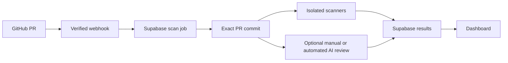

# AegisCode AI Suite

AegisCode reviews GitHub pull requests for security issues. A GitHub App sends
PR events to the backend; a durable worker fetches the exact commit and runs
Semgrep, Trivy, and TruffleHog in a separate scanner container. Results are
stored in Supabase and shown in a React dashboard. A separate manual review
window lets an operator copy a structured prompt into an AI chat and submit
its JSON reply. Automated AI review is optional and currently needs an API
key; the scanner workflow does not.

The project is an engineering case study. A finding is a lead for a developer
to investigate. “No findings” does not mean the code is secure. A failed or
incomplete scan must not be shown as clean.

## What works now

| Area | Current behavior |
| --- | --- |
| GitHub integration | Signed PR webhooks enqueue durable jobs; GitHub App installation access fetches a commit-pinned source snapshot. |
| Scanners | Isolated Semgrep, Trivy, and TruffleHog scan bounded source. Trivy also checks referenced Docker base images; it does not scan the final built image. |
| Results | Supabase stores scans and findings. The dashboard separates code/dependency findings from Docker image advisories. |
| Manual AI review | A separate signed-in window exchanges structured JSON with a chat model, supports bounded repository file tools, and stores its review steps. |
| Automated AI | An opt-in OpenAI context engine exists behind configuration and repository flags. It has mocked tests but has not been verified with a live API key. |
| Failure handling | Scanner failures and incomplete source remain failed. Manual review cannot turn a failed scan into a passed scan. |

The [review architecture and implementation plan](docs/ai-review-architecture.md)
describes planned work: graph-guided context, distinct scanner and AI finding
origins, citation validation, coverage records, optional free or local model
providers, resumable AI jobs, dashboard changes, and a measured benchmark.
Those features are **planned**, not current dashboard capabilities.

## How a PR moves through the system



The scanner gets source code as data; the service does not run the PR's
application or tests. The manual reviewer can ask the backend for selected
files at the pinned commit. Scanner output and AI output should be judged by
their evidence and limitations, not by a single score.

## Repository map

| Path | Purpose |
| --- | --- |
| `backend/app/api/` | Signed webhook, authenticated repository, and manual review endpoints. |
| `backend/app/services/` | GitHub source acquisition, scanner dispatch, review prompts, validation, and scan pipeline. |
| `backend/app/workers/` | Durable Supabase scan worker. |
| `backend/app/scanner_api.py` | API inside the isolated scanner container. |
| `frontend/src/` | Dashboard, sign-in, analytics, and separate manual review page. |
| `supabase/migrations/` | Database schema, tenant access rules, job dispatch, scanner, and manual review migrations. |
| `docs/` | Setup guides, scanner scope, security architecture, and implementation plan. |
| `docker-compose.yml` | Local API, worker, scanner, frontend, webhook gateway, and ngrok tunnel. |

## Local quick start

You need Docker Desktop or Docker Engine with Compose, a Supabase project, and
a GitHub App installed on a repository you may test. Use a test repository
first. The scanner workflow needs **no AI API key**.

1. Copy `.env.example` to a root `.env` if you do not already have one.
   Fill its Supabase, GitHub App, webhook secret, and ngrok values. Keep
   `.env` private. Do not paste private keys or the full file into chat.
2. Apply the migrations in `supabase/migrations/` in filename order. Configure
   GitHub OAuth and create an organization membership as described in
   [the live scan guide](docs/live-scan-pipeline.md).
3. From the **repository root**, start the services:

   ```sh
   docker compose up -d --build
   docker compose ps -a
   ```

4. Open `http://localhost:5173`. The API health route is
   `http://localhost:8000/health`.
5. Read `docker compose logs --tail=30 ngrok`, find the HTTPS tunnel URL,
   and put `<that-url>/api/v1/webhooks/github` in your GitHub App webhook
   settings. Configure the App's Pull request events and repository access.
6. Connect the repository with the backend CLI as shown in
   [the live scan guide](docs/live-scan-pipeline.md), then open or update a
   test PR. Watch `docker compose logs -f --tail=50 backend scan-worker`
   and refresh the dashboard.

The frontend at `localhost` and the ngrok webhook tunnel run while your
machine is on. This Compose setup is **not** an always-on public deployment.
Free hosted services have quotas and may change their terms. See
[Docker Compose setup](docs/docker-compose.md) for the full setup and rebuild
instructions and [webhook troubleshooting](docs/local-webhooks.md) for delivery
checks. SonarQube is not integrated.

## Manual review without an API key

After a scan record exists, open its **Manual review** link in the Recent pull
requests table. The review opens in a separate window and requires sign-in
because it can expose repository source. Copy the generated request into
your chosen AI chat, then paste only its required JSON response back into
the review window. The AI may request more repository files through the
bounded `list_files`, `list_special_files`, and `read_file` protocol.
Review the request before sharing private code with an external provider.

Read [Manual repository review](docs/manual-review.md) for the full workflow.
The manual review status and the scanner status are distinct: completing a
manual exchange does not repair a failed scanner run.

## Development checks

```sh
cd backend
python3 -m venv .venv
source .venv/bin/activate
pip install -r requirements-dev.txt
python -m pytest
python -m ruff check .
```

```sh
cd frontend
npm ci
npm run build
npm test
```

Tests use mocks for cloud providers. A local passing test suite does not
prove that a live GitHub installation, Supabase migration, provider account,
or public deployment is configured correctly.

## Privacy and review limits

- Supabase service credentials and GitHub App private keys belong only in
  server configuration. Browser variables beginning with `VITE_` are public.
- The scanner container has no tenant secrets. The webhook tunnel points to
  the restricted webhook gateway, not the full API.
- Source selection, scanner rules, and AI context are bounded. A model can
  miss a bug or misinterpret real code even when its file citation is valid.
- Docker findings currently describe referenced base images. They do not
  establish that a vulnerable package is reachable in the running app.
- A reliable benchmark requires human-reviewed answers, including benign PRs
  and vulnerabilities the system misses. The planned benchmark will report
  scanner and AI findings separately.

See [architecture notes](docs/architecture.md), [scanner scope](docs/scanner-suite.md),
and [the review plan](docs/ai-review-architecture.md) for details.
