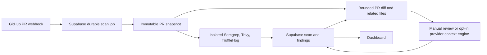
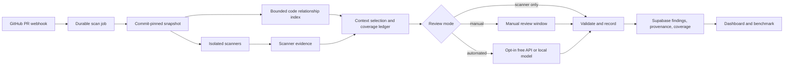

# AegisCode review architecture and implementation plan

## Purpose

AegisCode reviews GitHub pull requests with isolated scanners and optional AI.
Its goal is a useful, inspectable security review that reports both findings
and the limits of the review. It does not certify that a PR or repository is
secure. This is an extension of the existing web application, not a new CLI
project.

This document is the implementation plan. Sections marked **Current** describe
the repository today; sections marked **Planned** describe work to build and
test. The README is the entry point for people new to the project.

## Constraints and decisions

- **Keep the existing system.** GitHub App webhooks trigger durable Supabase
  jobs. The FastAPI backend, isolated scanner container, manual review window,
  Supabase tenant data, and React dashboard remain. The old diff-only AI
  adapter stays available for compatibility until it can be retired safely.
- **No required paid service.** Scanners, manual review, and benchmark runs must
  work without an LLM API key. Automated AI is opt-in through a free-tier
  provider such as Groq or a locally hosted Ollama model. No paid provider or
  billing upgrade is required by the project. Provider quotas and free hosting
  terms can change; the system must handle rate limits without reporting a
  clean AI review. A local Ollama model uses the operator's hardware.
- **Keep sources pinned.** Every diff, scanner result, graph snippet, file read,
  citation, and final finding belongs to one immutable PR commit. A new commit
  creates a new review. Never mix evidence from two commits.
- **No repository code execution.** Source indexing and scanning parse data in
  an isolated service. The review system does not run the PR's build scripts,
  test suite, containers, or arbitrary commands.
- **Separate finding origins.** Scanner findings and AI-proposed findings have
  distinct origins. An AI finding is a proposal even when its citation checks
  pass. A citation check proves that the cited source was available at the
  pinned commit; it does not prove the vulnerability or exploitability.
- **Honest status.** Scanner failure remains a failed scan. A completed scan
  with no findings means no supported findings in its defined scope, not “safe.”
  AI unavailable, incomplete context, and unverified findings have explicit
  states. A manual review never rewrites an earlier failed scan as passed.

## Current flow



**Current:** The scanner stage and fail-closed scan status are implemented.
The manual interface can exchange structured JSON with an external chat and
persist its steps. The opt-in automated context engine uses a bounded diff,
scanner summary, selected related files, and read-only repository tools. It has
a five-model-step limit and one required successful file read. Its OpenAI,
Groq, and Ollama paths have mocked tests but have not been validated live. The current
dashboard separates code/dependency findings from referenced Docker image
advisories. It does not yet show a coverage ledger or separate scanner findings
from AI-proposed findings. Automated AI steps are not resumable.

## Target flow



The three modes share context selection, finding validation, storage, and
reporting. Only the exchange with an LLM differs. Manual review remains a
supported mode, including after an automated provider is added.

## Finding and evidence contract

1. **Scanner finding:** Originates from Semgrep, Trivy, or TruffleHog. Preserve
   the scanner's rule/advisory ID, affected package or file, severity, raw
   evidence reference, and scan stage. AI may explain or challenge its relevance
   but must not turn the scanner's report into a verified exploit.
2. **AI-proposed finding:** Originates from a manual or automated LLM response.
   Require a concrete behavior, repository path, 1-based line, severity,
   source commit, and evidence references. Record whether the evidence was in
   the diff, initial context, or a successful tool read. Reject unsupported
   paths/lines or citations to content never supplied. Allow one-file proof
   where appropriate; require a second-file citation only when the claim
   depends on a caller, permission check, data flow, or configuration elsewhere.
3. **Evidence outcome:** Store `location_checked` or `unverified` separately
   from the finding's origin and severity; reject unsupported citations before
   saving the finding. Matching snippets and valid line numbers are structural
   checks, not semantic proof.
   Avoid claiming “scanner confirmed” for AI-only findings or assigning
   arbitrary confidence percentages. Give reviewers a human triage action.

   New manual reviews display numbered source lines and require each AI citation
   to include a short `line_excerpt` copied from the cited line. The backend
   fetches that file at the PR commit and rejects a citation when its excerpt
   does not occur on the stated line. The error names the path and line so the
   reviewer can ask the AI to read the file and correct its response. Reviews
   started before this requirement remain compatible. This checks the cited
   location; a human still needs to judge whether the line supports the security
   claim. Excerpts are used for validation and are not saved with findings.
4. **Deduplication:** Link overlapping scanner and AI records rather than
   double counting them. Keep both original sources and their provenance.
   Do not discard a new AI claim solely because it shares a file and line
   with a scanner advisory; compare the actual vulnerable behavior.
5. **Safe content:** Redact secret values in model prompts, tool output, logs,
   and dashboard evidence. Treat repository text as untrusted data, not
   instructions. Never pass GitHub or Supabase credentials to the model or
   isolated scanner process.

## Coverage and result semantics

Record the candidate file set, why each file was selected, which excerpts were
supplied, which full files were read, which were skipped or failed, and scanner
stage outcomes. Keep counts of scanner findings, AI proposals, accepted
citations, rejected citations, snippets supplied, and snippets cited. Display
“8 of 12 selected files read,” with the selection rule, rather than “67% of the
repository reviewed.” A file supplied to a model is not proof it was understood.

Coverage has a defined scope: selected code and configured scanner stages.
`complete` means all **required work in that scope** completed, not that the
whole repository is secure. `partial` means a budget or provider limit prevented
required AI/context work; `failed` means a required scanner or evidence stage
failed. Do not use a green “passed” label for a partial or failed review. The
ledger cannot list vulnerabilities the system never detected; only a benchmark
with a reviewed answer key can reveal those misses.

## Context and code graph

Start from changed files and changed symbols. Select likely direct callers,
imports, permission gates, data access, manifests, configuration, and relevant
scanner evidence. Supply a compact first batch, then allow bounded file reads
for unanswered questions. Record omitted and truncated context. Use source
snippets for routing; permit a full bounded file read when a claim requires it.

Build the relationship index from an isolated, read-only snapshot at the pinned
commit. Begin with a bounded one-hop graph and compare its selection against
the existing heuristic selection. An adapter may use `code-graph-rag`; pin its
version and test its behavior on untrusted repositories before making it
required. Its current documented default is an embedded SQLite graph, with
Memgraph optional, so a separate graph server is not a prerequisite. Support
fallback selection when a parser does not understand a language. Graph edges
are leads, not proof of reachability or complete data flow.

## Provider and job design

Keep scanner-only and manual modes usable with no API key. The automated
provider interface supports OpenAI, an optional Groq endpoint, and a local
Ollama server. Automated review remains disabled unless both the global and
repository settings opt in. Validate structured
responses in application code because provider JSON support and model behavior
vary. Rate limits and unavailable models mark AI work unavailable or partial;
they never create an empty “clean” AI result.

The present five-step automated loop is bounded by the scan worker lease.
Before increasing its budget, move AI work to a separately leased, resumable
job. Checkpoint accepted responses, tool calls, bounded tool results, next
step, token/time budget, and commit identity in Supabase. Use a lease token,
bounded retries, and idempotent writes. A crash between a provider response
and its checkpoint can repeat a call, so do not promise exactly-once billing.
After recovery works, set a bounded step budget from diff size, affected
files, security-sensitive changes, graph fan-out, and scanner findings.
Enforce independent limits for tokens, tool reads, time, and provider usage.

## Implementation order and acceptance checks

Stages 1 through 3 backend contracts, validation, and persistence are implemented. New findings carry
an origin and review mode, while historical rows with uncertain origin are
marked `unknown`. Commit-pinned evidence and coverage tables have tenant-safe
read policies and idempotent service writes. Manual and context-based automated
AI findings pass through one citation validator. It checks the pinned commit,
cited lines, supplied context, and requested cross-file references. The model
still decides when cross-file proof is needed; the validator cannot prove the
security claim itself. New review transitions persist cited locations and
per-file coverage outcomes in the same database transaction as their results.
The ledger records a bounded selection and acquired scanner snapshot; it does
not claim every source line was analyzed. Historical scans keep their unknown
provenance and are not backfilled with invented coverage. The dashboard does
not yet display the ledger. Apply migrations `202611060001_review_contracts.sql`
and `202611060002_coverage_ledger.sql` in order before deploying the updated
backend and worker.

1. **Baseline and contracts.** Freeze the current test results; define
   finding origin, evidence references, review mode, and coverage states in
   backend contracts. Existing stored rows remain readable. Add migration
   with tenant-safe read policies and idempotent writes. Verify prior scan
   and manual review tests remain green.
2. **Shared validation and provenance.** Route manual and automated AI
   findings through one validator. Test valid single-file evidence, necessary
   cross-file evidence, wrong commit, nonexistent line, redacted secret,
   duplicate finding, and content that was never supplied. Unverified
   location must not become a confirmed vulnerability.
3. **Coverage ledger.** Persist per-stage and per-file selection/inspection
   outcomes, including omission reasons. Confirm failed scanners remain
   failed and empty AI results with incomplete evidence cannot appear passed.
4. **Context graph and batching.** Build and query bounded relationships in
   the isolated service, then compare graph-enabled and graph-disabled context
   on fixed PR fixtures. Keep a safe fallback for unsupported languages or
   unavailable indexing.

   Implementation: the scanner service parses direct Python imports and
   relative JavaScript/TypeScript imports from the pinned snapshot. It returns
   path-only, one-hop neighbors to the worker; completed scans save these
   hints in `scan_context_graph`. Initial manual and automated prompts choose
   changed files, then graph neighbors, then heuristic matches within the
   existing eight-file and 64,000-character bounds. The graph is a selection
   hint, not proof that a code path executes. Graph unavailability does not
   change scanner results. Fixed fixtures compare graph and fallback choices.
   Apply `202611080001_scan_context_graph.sql` and rebuild scanner, worker,
   and backend before testing on a new PR. Stage 3's live gate below is
   complete. A new PR graph record and its first manual-review prompt were
   checked on PR #13.

   For the live check, open a new PR that changes a Python or relative
   JavaScript/TypeScript module imported by another file. After its scan
   completes, run this in the Supabase SQL Editor, replacing the PR number:

   ```sql
   select p.number, s.status, s.commit_sha,
          g.commit_sha as graph_commit, g.graph->'candidates' as candidates
   from public.pull_requests p
   join public.scans s on s.id = p.latest_scan_id
   left join public.scan_context_graph g on g.scan_id = s.id
   where p.number = 12;
   ```

   The graph commit must equal the scan commit. A missing row means the
   selection fallback was used; inspect the scan-worker log for a graph-hint
   warning. In a new manual review, the first prompt's `auto_context.graph`
   reports `used`, `not_selected`, `no_neighbors`, or `fallback`; review the actual
   `auto_context.included` paths rather than treating graph status as coverage.

5. **Review modes and providers.** Share prompts, tool rules, validation, and
   storage among scanner-only, manual, and automated modes. Groq and local
   Ollama are behind opt-in settings, with no key needed for local mode. Test rate-limit,
   malformed JSON, unavailable provider, and prompt-injection cases using
   mocked clients. Provider adapters are implemented and mocked tests pass;
   live provider testing still requires an operator-supplied key or local model.
6. **Resumable AI orchestration.** Split long AI review from the scan lease.
   Test crash/retry, stale lease, changed PR commit, duplicate webhook, and
   exhausted budgets. Preserve the original scanner outcome.
7. **Dashboard.** Show scanner findings, AI proposals, human triage, coverage,
   and scanner/AI availability separately. Keep Docker image advisories in
   their existing category. A filtered view must not imply absent findings
   elsewhere.
8. **Benchmark and documentation.** Create a small, versioned PR corpus with
   expert-reviewed answer keys, including benign PRs and scanner-missed
   cross-file bugs. Compare scanner-only, manual, automated, and graph on/off.
   Report scanner recall, AI-only recall and precision, combined recall with
   its precision cost, explanation quality, citation validity, coverage,
   latency, and provider failures separately. Do not publish a universal
   accuracy percentage from a small corpus. Document reproducible commands,
   limits, and case studies in the README and benchmark report.
9. **Deployment review.** Keep the current local Compose/ngrok workflow for
   development. A public dashboard and always-on scanner worker need hosting
   that can run the containers; a free static frontend alone cannot do that.
   Verify a no-paid-service deployment option and its quotas before
   advertising a persistent public demo. Until then, describe the app as
   locally runnable and demoable when the operator's machine is online.

### Stage 3 live verification gate — complete

These checks were completed before calling Stage 4 complete. Backend and
database tests cover ledger transitions; the live checks below verify saved
outcomes on actual PR scans.

1. On PR #18's scan, if it completed after the coverage migration, compare
   the scanner coverage `commit_sha` with the scan's `commit_sha`. Check that
   `selected_count` and `supplied_count` in
   `review_coverage.summary` equal the number of `scanner_only` file rows with
   `snapshot_acquired`. This outcome means the snapshot contained the file;
   it does **not** mean an AI read it or every scanner analyzed it.
2. Finish a manual review of that same scan with one successful `read_file`.
   Confirm its `manual` ledger has a `read_file` row for that path, supplied
   initial context paths have `supplied_context`, and omitted paths carry a
   reason. Confirm the coverage record and citations use the scan's commit SHA.
3. On a **new failed test scan**, confirm the scan and PR remain `failed`, the
   scanner ledger is `failed`, and no `passed` result appears after a manual
   review. Historical scans are not backfilled, so use a scan created after
   the coverage migration.

Record the PR numbers, scan IDs, outcomes, and date here when checked. Do not
mark this gate complete based only on a screenshot of the first 30 file rows.

#### Read-only SQL for the live gate

Run these in the Supabase SQL Editor. They only read records; they do not change
scan results. PR #18 is the safe review test. If its manual review has not yet
accepted the final JSON response, finish that review first. Use the GitHub PR
number, not the dashboard's total PR count.

1. Check the scanner snapshot for PR #18. The two commit columns must match,
   `coverage_status` must be `complete`, and the three counts must agree. This
   verifies that the snapshot was acquired, not that the AI read every file.

   ```sql
   select p.number, s.id as scan_id, s.status as scan_status,
          s.commit_sha as scan_commit, c.commit_sha as coverage_commit,
          c.status as coverage_status,
          (c.summary->>'selected_count')::integer as selected_count,
          (c.summary->>'supplied_count')::integer as supplied_count,
          (select count(*) from public.review_coverage_files f
           where f.scan_id = s.id and f.review_mode = 'scanner_only'
             and f.outcome = 'snapshot_acquired') as snapshot_files
   from public.pull_requests p
   join public.repositories r on r.id = p.repository_id
   join public.scans s on s.id = p.latest_scan_id
   left join public.review_coverage c on c.scan_id = s.id
     and c.review_mode = 'scanner_only'
   where r.full_name = 'LP-Ishadi/AegisCode-AI-Suite' and p.number = 18;
   ```

2. Check the manual review for PR #18. The manual coverage row must use the
   same commit; after a completed review it must say `complete`. The requested
   `manual_reviews.py` must have a `read_file` outcome. Other supplied files
   may say `supplied_context`; omitted files, if any, must have a reason. An
   empty list of omitted files is valid.

   ```sql
   select p.number, s.id as scan_id, s.commit_sha as scan_commit,
          c.commit_sha as coverage_commit, c.status as coverage_status,
          c.summary->>'read_count' as read_count,
          f.file_path, f.outcome, f.reason
   from public.pull_requests p
   join public.repositories r on r.id = p.repository_id
   join public.scans s on s.id = p.latest_scan_id
   left join public.review_coverage c on c.scan_id = s.id
     and c.review_mode = 'manual'
   left join public.review_coverage_files f on f.scan_id = s.id
     and f.review_mode = 'manual'
   where r.full_name = 'LP-Ishadi/AegisCode-AI-Suite' and p.number = 18
   order by f.file_path;
   ```

   PR #18 has no AI findings, so it cannot check citation storage. For a review
   that saved an AI finding, use its GitHub PR number in this query (PR #16 was
   the permission-bypass test). Each citation commit must match the scan.

   ```sql
   select p.number, s.commit_sha as scan_commit,
          e.commit_sha as citation_commit, e.file_path, e.line, e.source
   from public.pull_requests p
   join public.repositories r on r.id = p.repository_id
   join public.scans s on s.id = p.latest_scan_id
   join public.findings f on f.scan_id = s.id and f.origin = 'ai'
   join public.finding_evidence e on e.finding_id = f.id
   where r.full_name = 'LP-Ishadi/AegisCode-AI-Suite' and p.number = 16
   order by e.file_path, e.line;
   ```

3. Find a failed scan created after the coverage migration. A completed manual
   review on that scan must leave both `pr_status` and `scan_status` as `failed`,
   with scanner coverage `failed`. This query shows the latest candidates. If
   it returns no completed manual review, create a fresh, unmerged test PR that
   adds `.semgrepignore` containing `**/*`, wait for its scan to fail, then
   finish a manual review with no findings. Run this query again.

   ```sql
   select p.number, p.status as pr_status, s.id as scan_id,
          s.status as scan_status, s.error_code,
          c.status as scanner_coverage_status,
          c.summary->>'reason' as coverage_reason,
          m.status as manual_review_status
   from public.pull_requests p
   join public.repositories r on r.id = p.repository_id
   join public.scans s on s.id = p.latest_scan_id
   join public.review_coverage c on c.scan_id = s.id
     and c.review_mode = 'scanner_only'
   left join public.manual_reviews m on m.scan_id = s.id
   where r.full_name = 'LP-Ishadi/AegisCode-AI-Suite'
     and s.status = 'failed'
   order by s.created_at desc
   limit 10;
   ```

Verification log (2026-11-08): local coverage, contract, manual review, and
evidence tests passed (38 tests and 4 subtests). PR #13 previously showed
matching scanner counts of 125 in a screenshot. PR #18's AI requested
`manual_reviews.py` and returned no findings, as expected for its safe change;
its completed manual coverage confirms the final response was submitted. The
live PR #18 scanner query returned scan
`51a49e21-2640-4583-9d00-12b476dad394` with matching
scan/coverage commits, `complete` scanner coverage, and selected/supplied/
snapshot counts of 126/126/126. This verifies gate item 1 for that scan.
The same PR #18 scan has `complete` manual coverage at the matching commit:
`read_count` is 1, `backend/app/api/manual_reviews.py` is `read_file`, and four
other files are `supplied_context`. No omitted paths were recorded, so no
omission reason needs checking for this scan. This verifies gate item 2's
file-coverage outcomes. PR #16 has four saved AI citations; all four citation
commits match that scan's commit (`cc0597a478a27d6aedc870e6f28de9dadbe25c75`).
This verifies commit pinning for saved citations, not whether each cited line
supports the claim. The previously observed inaccurate PR #16 line references
remain a separate quality finding. An initial failed-scan query returned zero
eligible rows. A fresh unmerged PR #19 then produced `source_incomplete`; after
an empty manual review completed, its PR and scan statuses remained `failed`,
and scanner coverage remained `failed` with reason `source_incomplete`. This
verifies gate item 3 for that failure case. The captured PR #19 query did not
include its scan ID. Stage 3's live gate is **complete** for these tested cases.

Each stage is complete only when its meaningful tests and documentation are
updated. Do not introduce a new status or provider in the UI before its
backend contract and persistence are defined.

## What the operator must supply

- Existing Supabase project credentials and GitHub App configuration for
  webhook-driven scans. Keep private keys in the root `.env`; never paste them
  into an issue, chat, or benchmark.
- For Groq automated mode only: a Groq account and API key. For local Ollama mode only: a running local
  model with adequate hardware. Neither is required for scanners or manual
  review.
- For a persistent public demo: a chosen hosting environment that can run
  the API, worker, and scanner containers without a paid plan. The current
  Compose setup serves the app only while the operator's machine is running.
- For meaningful accuracy claims: human-reviewed benchmark answers and
  review of disputed AI proposals. The harness can calculate metrics, but
  it cannot create a trustworthy answer key on its own.

## Known limits

Static scanners and parsers miss behaviors. A one-hop graph misses indirect
calls, reflection, generated code, and external authorization. Model output
can misread real code even when every citation is valid. The context budget
prevents exhaustive repository review; scanner advisory databases and free
provider quotas change. The current image scanner checks referenced base
images, not the final built application image. A successful review therefore
remains evidence for human judgment, never a security guarantee.

## Sources for implementation decisions

- [OWASP secure code review guidance](https://cheatsheetseries.owasp.org/cheatsheets/Secure_Code_Review_Cheat_Sheet.html)
- [NIST Secure Software Development Framework](https://nvlpubs.nist.gov/nistpubs/SpecialPublications/NIST.SP.800-218.pdf)
- [Code-Graph-RAG project and graph backend documentation](https://github.com/vitali87/code-graph-rag)
- [Groq OpenAI compatibility and rate limits](https://console.groq.com/docs/openai)
- [Ollama local API documentation](https://docs.ollama.com/api/introduction)
